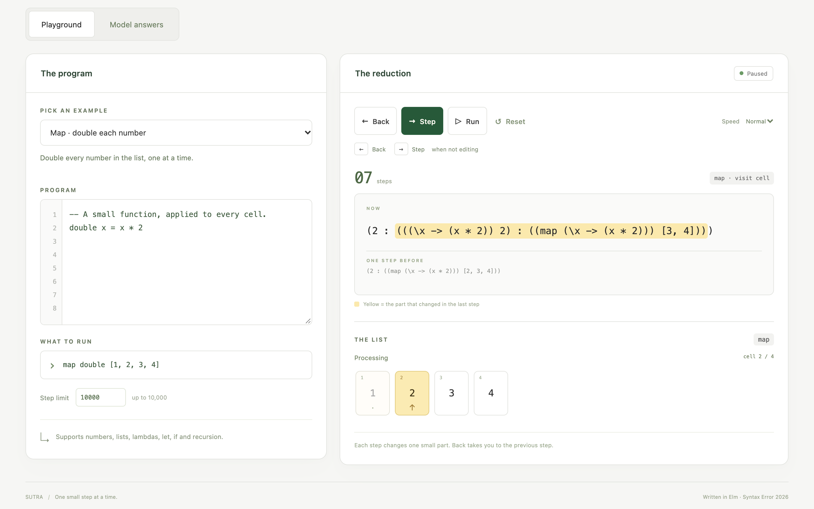
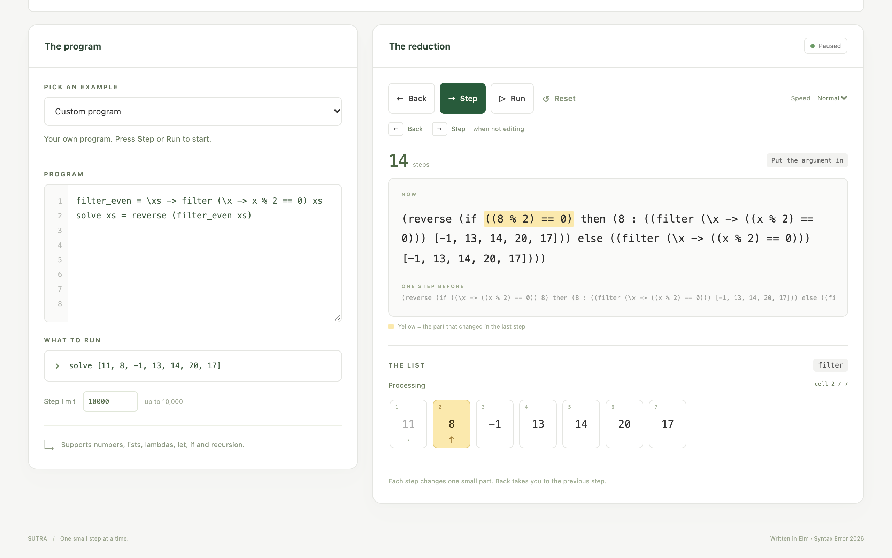
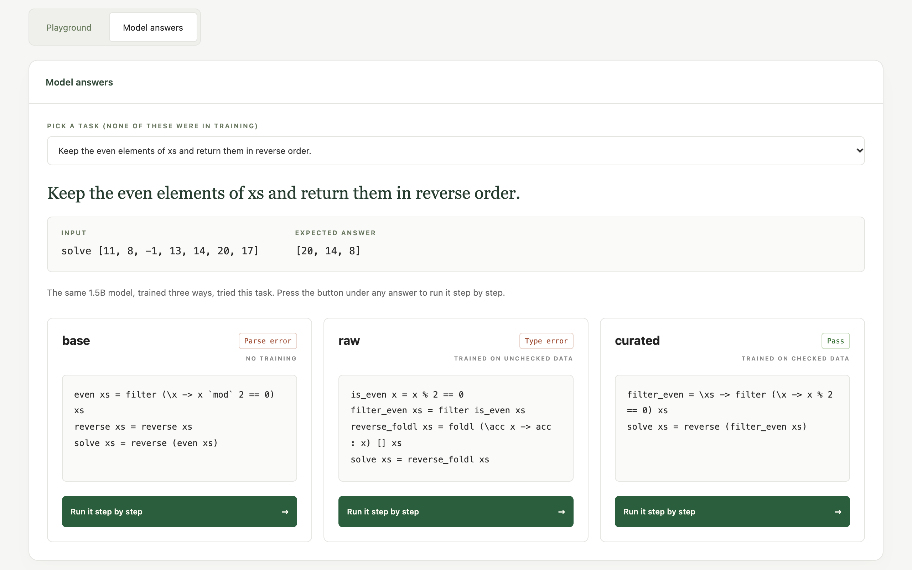

# Sutra interpreter and playground (Elm)

This folder has the Sutra interpreter, the step-by-step playground in the browser, and a small Node
command line tool that the LLM pipeline uses to check programs. The language itself is described in
[`SPEC.md`](../SPEC.md).

The parser, the interpreter and the printer are written in **Elm**. The browser page and the command
line tool use the same Elm code. Node only does the input/output for the command line tool.

## Build and test

You need Node 20 or newer. From this folder:

```sh
npm ci
npm run build
npm test
```

Elm is installed locally as a dev dependency, not globally. Its package cache is `.elm-cache/` in this
folder. Elm packages are downloaded once at build time; after that, the page and the tool never use
the network. Playwright is only used for the browser tests.

## Using the playground

After `npm run build`, open **[index.html](index.html)** in a browser. On a Mac, from the project root:

```sh
open fp/index.html
```

It loads only local files (`assets/style.css`, `dist/visualizer.js`, `assets/showcase.js`). No server,
no account, no internet.

- Write your own program and expression, or pick one of six examples: map, filter, foldl sum, foldr,
  factorial, and a `let`.
- **Step** (or the right arrow key) does one step. **Back** (or the left arrow key) goes to the step
  before, with the same expression, highlight, list box and running total.
- **Run / Pause** plays the steps at the speed you choose. It stops at a value, an error or the step
  limit.
- **Reset** reads your program again and starts over. If you edit the program, the next Step or Run
  starts from your new code.
- The part that changed in the last step is shown in yellow. The expression before the step is shown
  below it.
- When `map`, `filter`, `foldl` or `foldr` is running, the list is drawn as boxes and the current box
  is lit. `foldl` shows its running total. `foldr` first opens up the list, then shows the total while
  it combines from the right.
- Parse errors, type errors, runtime errors, unknown names and `step_limit` each get a clear message.
  The step limit can be set from 0 to 10,000.

Browser tests (the first command downloads a test browser into this folder):

```sh
PLAYWRIGHT_BROWSERS_PATH=.playwright-browsers npx playwright install chromium --only-shell
npm run test:ui
```

They open the page from disk, try all the buttons, run all six examples and compare them with the
command line tool, check both folds, every error type and the phone layout, and make sure the page
makes no network requests.

## Model answers

The **Model answers** tab shows, for each of the 39 test tasks, the first answer written by three
versions of the same 1.5B model: **base** (no training), **raw** (trained on unchecked data) and
**curated** (trained on checked data), with the interpreter's result for each. **Run it step by step**
loads that answer into the playground so you can step through it.

The data is in `assets/showcase.json`. It is written by `llm/showcase.py` from the real test run.
`assets/showcase.sample.json` is a made-up two-task file used only by the tests; if it is ever shown,
a banner says so. To make the data again:

```sh
cd llm && python showcase.py runs/latest/train_eval
cd ../fp && npm run build:showcase
```

Then reload `index.html`. No Elm rebuild is needed. The build step checks the JSON and writes
`assets/showcase.js`, which the page loads as a normal script, so it still works from disk.

The result badge comes from the data as it is. When you step through an answer, the playground runs
only the one example shown on screen, not the full test set. `npm run test:showcase` tests this tab.

## Screenshots

Real screenshots of `index.html` opened from disk in a browser.







[foldl with its running total](docs/screenshots/foldl.png) · [Phone view](docs/screenshots/mobile.png) ·
[Model answers on a phone](docs/screenshots/showcase-mobile.png)

## Examples you can run

The six examples are also plain `.sutra` files. From the project root:

```sh
node fp/dist/sutra.js run fp/examples/factorial.sutra --expr "fact 5"
# 120
```

| File in `fp/examples/` | Expression | Value |
|---|---|---|
| `map.sutra` | `map double [1, 2, 3, 4]` | `[2, 4, 6, 8]` |
| `filter.sutra` | `filter isEven [1, 2, 3, 4, 5, 6]` | `[2, 4, 6]` |
| `foldl.sutra` | `foldl add 0 [1, 2, 3, 4]` | `10` |
| `foldr.sutra` | `foldr prepend [] [1, 2, 3, 4]` | `[1, 2, 3, 4]` |
| `factorial.sutra` | `fact 5` | `120` |
| `let.sutra` | `let doubled = 3 * 2 in doubled + 1` | `7` |

## Command line tool

The build makes **`fp/dist/sutra.js`**, one file that runs with Node 20 or newer. You can copy it
anywhere; it does not need `node_modules`, Elm or the internet. From the project root:

```sh
node fp/dist/sutra.js check < fp/test/check_sample.jsonl > results.jsonl
node fp/dist/sutra.js run fp/test/programs/examples.sutra --expr "solve [1,2,3]"
node fp/dist/sutra.js trace fp/test/programs/examples.sutra --expr "map double [1,2,3]" --json
```

- `check` reads one JSON item per line and writes exactly one result per line, in the same order
  (format in `SPEC.md` 5.1). `test/check_sample.expected.jsonl` is the exact expected output for the
  sample input.
- A broken input line gives a `bad_input` result. A program that does not parse gives an empty test
  list. Each test runs fresh, and one failing test does not skip the others. A wrong answer has
  `ok: false` with `error: null`, because it is not an interpreter error. Answers are compared as
  exact strings in the standard printed form.
- `run` prints only the value. `trace` prints every step; with `--json` it prints one object with
  `initial`, `trace`, `value`, `error` and `steps`. Both take `--max-steps N` (default 10,000).
- `check` exits with 0 after reading all input; look at each result's `ok`. `run` and `trace` exit
  with 1 on a language error and 2 on wrong usage. Blank lines give `bad_input`, empty input gives no
  output, and Windows line endings work.

### Safety limits

Machine-written programs can be weird, so the checker protects itself. An input line over 1 MiB is
skipped. Elm runs in a separate worker with a 128 MiB heap and a 4 MiB stack, and each program gets
5 seconds. If a worker crashes, that one item gets an error and a fresh worker takes over for the next
item. For an item stopped this way, `steps: 0` only means "no count available", not "zero steps".

## Files

| File | What it does |
|---|---|
| `src/Sutra/Ast.elm` | The syntax tree, values, and safe substitution (renames variables when needed) |
| `src/Sutra/Parser.elm` | Reads source text, handles indented definitions and operator order |
| `src/Sutra/Eval.elm` | The step-by-step interpreter (call-by-value, leftmost innermost first) |
| `src/Sutra/Print.elm` | Prints values in the standard form and expressions in a readable form |
| `src/Cli.elm` | The Elm worker behind the command line tool |
| `src/Main.elm` | The browser app: editors, playback, errors, layout |
| `src/Sutra/Session.elm` | Step history and which list box is active |
| `src/Sutra/ExpressionView.elm` | Draws the expression with the changed part highlighted |
| `src/Sutra/Examples.elm` | The six examples |
| `src/Sutra/Showcase.elm` | The Model answers tab |
| `index.html`, `assets/style.css` | The page and its styles |
| `examples/*.sutra` | The six examples as files |
| `docs/screenshots/` | Screenshots |
| `cli/runtime.cjs` | Line-by-line input/output and the worker that restarts on crashes |
| `scripts/build.cjs`, `scripts/build-showcase.cjs` | Builds the Elm code and the Model answers data |
| `test/Worker.elm` | A small Elm wrapper used only by the tests |
| `test/core.test.cjs` | Language cases, step traces, number checks, speed |
| `test/cli.test.cjs` | The command line tool, broken input, crash recovery, run and trace |
| `test/visualizer.test.cjs`, `test/showcase.test.cjs` | Browser tests for the playground and the Model answers tab |

Each step of the interpreter returns the next expression, the name of the rule used, where in the
expression the change happened, and which list box is active (with the running total for folds).
The browser uses exactly this, it does not fake an animation.

## How it is built

**Small steps are real steps.** `Eval.step` returns the next expression. The command line `trace` and
the browser both use it. Doing math, calling a lambda, putting in a `let` value, picking an `if` side
and opening a definition are all separate steps.

**Lists go one box at a time.** The rules look like this:

```text
map f (x : xs)       -> f x : map f xs
filter p (x : xs)    -> if p x then x : filter p xs else filter p xs
foldl f z (x : xs)   -> foldl f (f z x) xs
foldr f z (x : xs)   -> f x (foldr f z xs)
```

Arguments are worked out before a function is called. `foldl` carries its running total forward.
`foldr` first opens up the whole list, then combines from the right, and the playground follows that
same order.

**Back means going back to a saved state.** Every step is saved: the expression, the step count, the
highlight, the list box and any error. Back just shows the earlier saved state, it does not try to undo
anything. Editing or Reset starts a new history.

**Names work the normal way.** Top-level definitions are looked up when used, so they can call
themselves and each other. When a lambda is called, its argument is put in, and variables are renamed
if needed so nothing gets mixed up. `let` cannot refer to itself.

## Language details

`SPEC.md` leaves a few things open. This is what the interpreter does:

- Top-level definitions start at the first column. Indented lines continue the definition above.
  Comments and blank lines are skipped. Defining the same name twice, or the same parameter twice, is
  a parse error. Names can have letters, digits, `_` and `'`, and must start with a letter or `_`.
  Keywords and `True`/`False` cannot be used as names.
- Function calls group to the left. `f -3` means `f` minus 3, same as `x-3`. To pass a negative
  number, write `f (-3)`.
- Arguments are worked out before the call, and a `let` value is worked out before it is used.
  Definitions are opened when used. A lambda's body is not touched until it is called.
- `if` only works out the side it picks. `&&` and `||` stop early once the left side decides the
  answer. `%` goes with division that rounds toward zero: `-7 / 3 = -2` and `-7 % 3 = -1`.
- Numbers are exact whole numbers up to ±9,007,199,254,740,991. A number literal outside this range is
  a parse error, and a result outside it is a runtime error. The tests check the math against Node's
  BigInt.
- `==` compares numbers, booleans and lists. Comparing functions or different kinds of values is a
  type error. `<`, `>` and friends only work on numbers. Builtins take arguments one by one, and your
  own names can hide a builtin's name.
- `map`, `filter`, `foldl` and `foldr` take one list box per step. Other builtins can finish in one
  step. A `range` longer than 10,000 items is a runtime error.
- One expression or definition can be at most 100,000 characters, and one step can go at most 512
  levels deep into the expression. These are safety limits, separate from the step limit.

## Tests

`npm test` runs 99 language cases (every example from `SPEC.md` included), step-by-step checks, 200
division and remainder checks against Node's BigInt, and a check that items do not leak into each
other. The command line tests cover the sample file, broken input, crash recovery, run, trace and
copying the tool somewhere else. 1,000 items (2,000 tests) take about 2 seconds.

`npm run test:ui` and `npm run test:showcase` are the browser tests described above.

## Prior work

None. All code and tests in this folder were written during Syntax Error 2026. Elm and its standard
packages are used as dependencies. I read the official docs; no existing interpreter or outside code
was copied.
